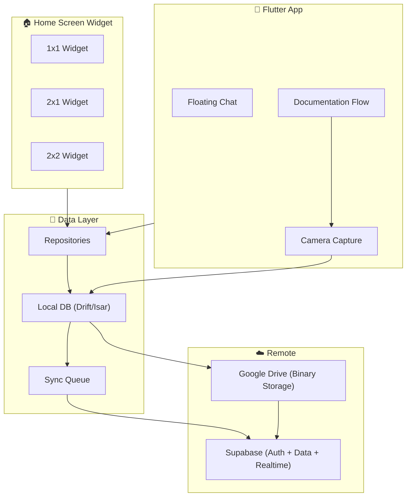
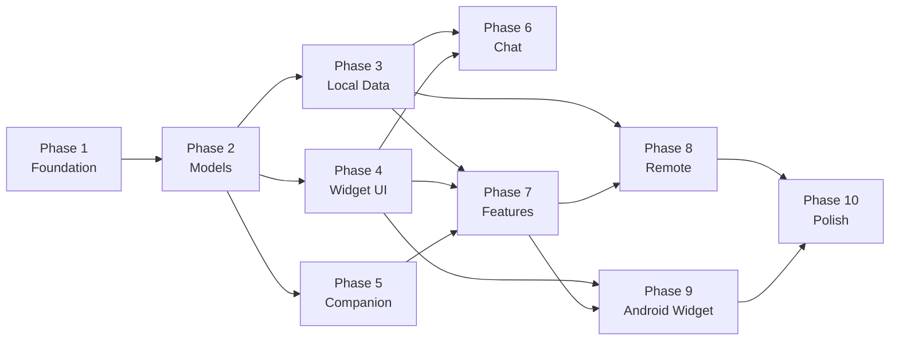

# 🚀 Jejak Saku — Implementation Plan

## Design Reference


---

## Project Status: **Fresh Start** (empty project)

> [!IMPORTANT]
> Project masih kosong — hanya ada `CLAUDE.md`. Semua harus dibangun dari nol mengikuti PRD dan master prompt yang sangat detail (2192 baris spesifikasi).

---

## Architecture Overview



---

## Phased Implementation

### Phase 1 — Project Foundation
> **Goal:** Flutter project scaffold + architecture + theme

| # | Task | Detail |
|---|------|--------|
| 1.1 | Create Flutter project | `flutter create` with proper package name |
| 1.2 | Setup `pubspec.yaml` | Core dependencies (provider, drift/isar, supabase_flutter, googleapis, home_widget, image_picker) |
| 1.3 | Architecture scaffold | `lib/core/`, `lib/data/`, `lib/domain/`, `lib/features/`, `lib/services/` |
| 1.4 | Theme system | `AppColors`, `AppTypography`, `AppRadius` — all colors from design spec |
| 1.5 | Constants | Widget sizes, spacing, border definitions |

**Color Palette dari Design:**
```
Widget Background: #BECFD8
Reminder:          #6D8A9A
Date:              #919FAC
Documentation:     #AC3F42
Attendance:        #6D8A9A
Chat:              #F6E7A8
```

---

### Phase 2 — Domain Models
> **Goal:** Data models yang menjadi foundation semua fitur

| # | Model | Key Fields |
|---|-------|------------|
| 2.1 | `Reminder` | id, title, scheduledAt, status, priority |
| 2.2 | `Attendance` | id, date, status (masuk/izin/sakit/libur), syncStatus |
| 2.3 | `Documentation` | id, fileName, driveFileId, driveUrl, fileType, fileSize, capturedAt, taskId, activityId, syncStatus |
| 2.4 | `Task` | id, title, status, dueDate, completedAt |
| 2.5 | `ChatMessage` | id, conversationId, sender, content, type, createdAt, isPersistent, metadata, syncStatus |
| 2.6 | `CompanionState` | Enum: idle, happy, working, reminder, documentation, learning, syncing, offline, success |
| 2.7 | `SyncStatus` | Enum: synced, pending, syncing, failed, offline |

---

### Phase 3 — Local Data Layer
> **Goal:** Offline-first dengan local database

| # | Task | Detail |
|---|------|--------|
| 3.1 | Database setup | Drift atau Isar untuk local storage |
| 3.2 | DAOs | CRUD operations per entity |
| 3.3 | Sync queue table | Queue untuk pending sync operations |
| 3.4 | Local cache layer | Widget state cache untuk fast loading |

**Architecture:**
```
Widget → Local Widget State → Repository → Local DB → Sync Queue → Supabase
```

---

### Phase 4 — Widget UI Components
> **Goal:** Semua visual components sesuai design reference

| # | Component | Specs |
|---|-----------|-------|
| 4.1 | `JejakSakuWidget` | Main container, bg #BECFD8, radius 25, soft shadow |
| 4.2 | `CompanionCircle` | Abstracted robot area, radius 25, state-driven |
| 4.3 | `WidgetDivider` | Vertical separator, 1px, white/translucent |
| 4.4 | `ReminderPill` | bg #6D8A9A, radius 18, white stroke, shadow |
| 4.5 | `DatePill` | bg #919FAC, radius 12, realtime date/day |
| 4.6 | `DocumentationButton` | bg #AC3F42, radius 12, camera icon |
| 4.7 | `AttendanceDropdown` | bg #6D8A9A, radius 12, dropdown selection |
| 4.8 | `ChatPill` | bg #F6E7A8, vertical pill, chat icon |

**Widget Layouts:**
```
1x1: CompanionCircle + status label
2x1: Companion | Divider | Reminder + Date + Doc + Attendance | Chat
2x2: Companion + Greeting + Sync | Reminder + Schedule | Foto + Task + Jadwal | Chat
```

---

### Phase 5 — Companion System
> **Goal:** Pluggable companion yang state-driven

| # | Task | Detail |
|---|------|--------|
| 5.1 | `CompanionState` enum | 9 states (idle, happy, working, etc.) |
| 5.2 | `CompanionRenderer` | Abstract renderer — supports placeholder, image, Lottie, Rive |
| 5.3 | `CompanionProvider` | State management untuk companion |
| 5.4 | Placeholder visuals | Simple emoji/icon-based placeholder (bukan final) |
| 5.5 | Information surface | Contextual text under companion (time, task count, greeting) |

---

### Phase 6 — Floating Chat
> **Goal:** Chat overlay dengan persistent + ephemeral message system

| # | Task | Detail |
|---|------|--------|
| 6.1 | `FloatingChatOverlay` | Overlay/bottom sheet, bukan full page |
| 6.2 | `ChatHeader` | "Jejak Saku" + close button |
| 6.3 | `ChatHistory` | ScrollView persistent messages |
| 6.4 | `ChatComposer` | Input + send button, autofocus |
| 6.5 | `SlashCommandMenu` | Autocomplete popup on "/" |
| 6.6 | `CommandResultCard` | Compact result cards |
| 6.7 | Message persistence | Normal = persistent, Slash = ephemeral UI |
| 6.8 | Chat ViewModel | State management chat flow |

**Slash Commands:**
```
/jadwal    /reminder    /aktivitas    /belajar
/status    /dokumentasi /task         /catatan
```

---

### Phase 7 — Feature Flows
> **Goal:** Core user flows yang functional

| # | Feature | Flow |
|---|---------|------|
| 7.1 | **Documentation** | Widget → Camera → Preview → Save → Local → Drive → Supabase |
| 7.2 | **Attendance** | Widget → Dropdown → Select → Local DB → Sync → Supabase |
| 7.3 | **Reminder** | Create → Scheduled → Widget Display → Notification → Complete |
| 7.4 | **Date/Day** | Realtime date with contextual display ("Hari ini", "Senin", "20/04") |

---

### Phase 8 — Remote Integration
> **Goal:** Supabase + Google Drive integration

| # | Task | Detail |
|---|------|--------|
| 8.1 | Supabase setup | Auth, tables, realtime subscriptions |
| 8.2 | Google Drive API | OAuth, file upload, file ID retrieval |
| 8.3 | Sync service | Background sync with retry logic |
| 8.4 | Realtime updates | Supabase realtime → Local state → Widget refresh |

---

### Phase 9 — Android Home Screen Widget
> **Goal:** Native Android widget yang berkomunikasi dengan Flutter app

| # | Task | Detail |
|---|------|--------|
| 9.1 | `home_widget` package setup | Platform channel Flutter ↔ Android |
| 9.2 | Android widget provider | Kotlin `AppWidgetProvider` |
| 9.3 | Widget layouts XML | 1x1, 2x1, 2x2 responsive layouts |
| 9.4 | Widget ↔ App communication | Shared preferences / method channels |
| 9.5 | Widget click handlers | Deep links ke specific app screens |

---

### Phase 10 — Polish & QA
> **Goal:** Production-ready quality

| # | Task | Detail |
|---|------|--------|
| 10.1 | Overflow audit | Zero overflow di semua ukuran |
| 10.2 | Empty states | Honest empty states (bukan fake data) |
| 10.3 | Error states | Proper error handling + retry |
| 10.4 | Offline behavior | Full offline-first verification |
| 10.5 | Performance | Lightweight widget, cached state |
| 10.6 | Security | No tokens in widget layer |

---

## Dependency Map



---

## Key Dependencies (pubspec.yaml)

| Package | Purpose |
|---------|---------|
| `provider` | State management (ChangeNotifier/MVVM) |
| `drift` / `isar` | Local database |
| `supabase_flutter` | Backend (auth, DB, realtime) |
| `googleapis` + `google_sign_in` | Google Drive API |
| `home_widget` | Android home screen widget |
| `image_picker` / `camera` | Documentation capture |
| `flutter_local_notifications` | Reminder notifications |
| `connectivity_plus` | Network status |
| `intl` | Date/time formatting |
| `google_fonts` | Typography (Inter/Manrope/Plus Jakarta Sans) |

---

## Recommended Starting Point

> [!TIP]
> **Mulai dari Phase 1 → 2 → 4 (UI components)** untuk mendapatkan visual feedback secepat mungkin, lalu build data layer dan integrations secara iteratif.

Phases 1-5 bisa dikerjakan dalam satu iterasi besar pertama karena mereka membentuk core experience — **widget yang bisa dilihat dan diinteraksi**.

---

## Estimated Scope

| Phase | Complexity | Files |
|-------|-----------|-------|
| Phase 1 | 🟢 Low | ~15 files |
| Phase 2 | 🟢 Low | ~10 files |
| Phase 3 | 🟡 Medium | ~15 files |
| Phase 4 | 🟡 Medium | ~12 files |
| Phase 5 | 🟢 Low | ~6 files |
| Phase 6 | 🔴 High | ~15 files |
| Phase 7 | 🔴 High | ~20 files |
| Phase 8 | 🔴 High | ~15 files |
| Phase 9 | 🟡 Medium | ~10 files |
| Phase 10 | 🟡 Medium | ~5 files |
| **Total** | | **~120+ files** |
